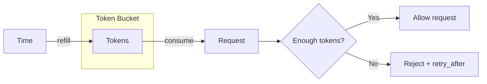
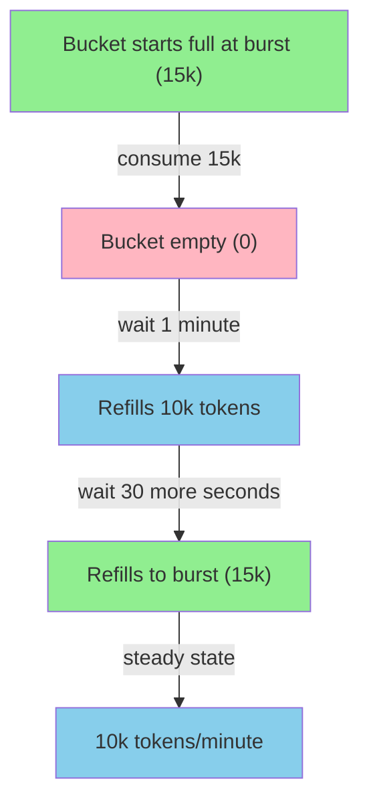
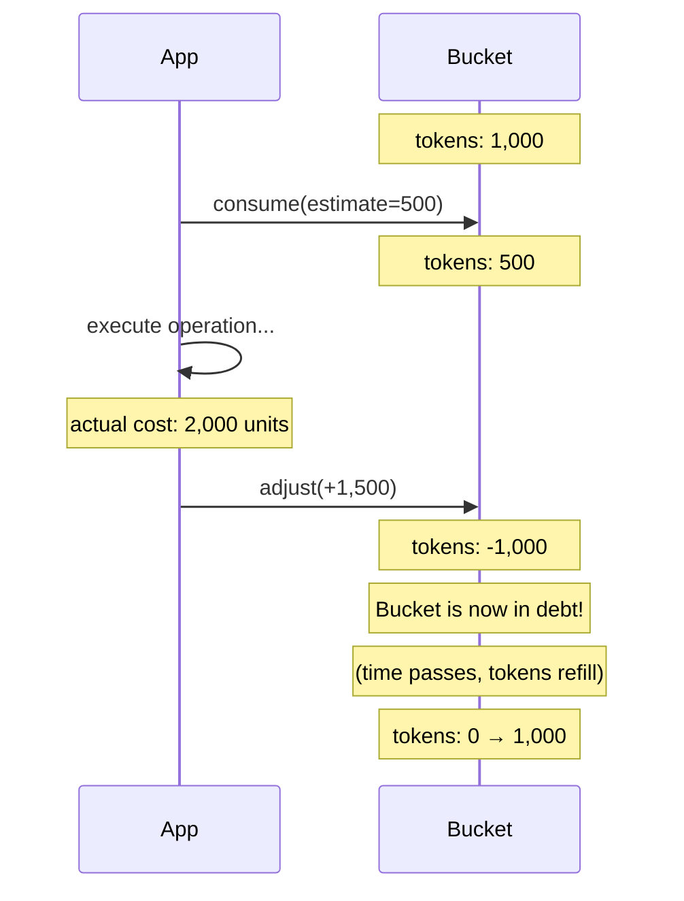

# Token Bucket Algorithm

Understanding how rate limiting works helps you choose the right limits for your application. This page explains the token bucket algorithm and how zae-limiter implements it.

## The Classic Algorithm

The token bucket algorithm controls request rates using a simple metaphor: imagine a bucket that holds tokens.

- **Tokens accumulate** over time at a fixed rate (the refill rate)
- **Requests consume** tokens from the bucket
- **Requests are allowed** if enough tokens are available
- **Requests are rejected** if the bucket is empty



This creates a natural rate limit: requests can consume up to the bucket's capacity, but sustained traffic is limited by the refill rate.

## How zae-limiter Implements It

zae-limiter uses a modified token bucket optimized for distributed systems. Here's how it differs from the classic algorithm:

| Aspect | Classic Algorithm | zae-limiter |
|--------|-------------------|-------------|
| Token storage | Floating-point numbers | Integers (millitokens x1000) |
| Refill timing | Continuous background process | Lazy (calculated on-demand) |
| Refill rate | Fixed | Fixed, or varied per cron window |
| Recovery | Always a drip | A drip, or a whole allowance restored at a calendar instant |
| Minimum tokens | 0 (never negative) | Can go negative (debt) |
| Precision | May drift due to float errors | Drift-compensated integers |

These modifications enable:

- **Distributed precision**: Integer math produces identical results across all nodes
- **Efficiency**: No background timers or processes needed
- **Estimate-then-reconcile**: Negative buckets allow post-hoc cost adjustment

## Key Concepts

### Capacity and Burst

A dripping limit has a **rate** (sustained throughput) and an optional **burst** (the bucket
ceiling). A quota has neither: its capacity is the whole allowance for one window, and it does
not drip at all.

```python
# 10,000 tokens/minute sustained, bucket holds up to 10k
Limit.per_minute("tpm", 10_000)

# 10,000 tokens/minute sustained, but allow bursts up to 15k
Limit.per_minute("tpm", 10_000, burst=15_000)
```



**Key insight**: When `burst` is set, the bucket is larger than the refill rate. After fully depleting a 15k burst bucket that refills at 10k/minute, it takes **1.5 minutes** to return to full capacity. Without `burst`, the bucket ceiling equals the rate.

**When to use burst:**

- **Startup surge**: Handle initial traffic before steady state
- **Bursty workloads**: Allow temporary spikes followed by quiet periods
- **User experience**: Don't reject the first request just because a minute hasn't passed

### Bursts Are Strict

The capacity is a ceiling over every stretch of time, not an average. Over any window, a
dripping limit admits at most its capacity plus what refills during that window. A bucket
cannot bank idle time: once it is full, waiting longer adds nothing, so a bucket that sat idle
for an hour admits one burst of at most its capacity, not two.

```python
# Idle for an hour, then a flood of requests:
Limit.per_minute("rpm", 100)
# admits 100 at once, then about 100 per minute.
# Over any 30 seconds: at most 100 + 50 = 150.
```

This holds however many processes share the bucket and however it is
[sharded](#sharded-buckets). Each process stamps its writes with its own clock, so the bound
allows a little for clock skew and time in flight: at most `2 × r × s` extra tokens, where `r`
is the refill rate and `s` the largest gap between a process's clock reading and the moment its
write lands. At 10,000 tokens per minute with clocks and round trips within 100 ms, that is
about 33 tokens.

The guarantee does not cover what you have chosen not to enforce:
[soft limits and bypass](soft-limits-and-bypass.md), and requests admitted under
`on_unavailable="allow"` while DynamoDB is unreachable. An operator
[reset or top-up](reset-and-top-up.md) adds what it grants. A quota does not drip, so it follows
its own rule: one allowance per window.

!!! note "v0.18.0"
    Before v0.18.0 a bucket that sat full could admit close to twice its capacity in a short
    burst. The strict bound needs every client and Lambda sharing the table to run v0.18.0 or
    later.

### Lazy Refill

Unlike traditional implementations that continuously add tokens, zae-limiter calculates refills on-demand:

```
When a request arrives:
1. Calculate elapsed time since last refill
2. Add tokens based on elapsed time
3. Check if enough tokens are available
4. Consume tokens if allowed
```

**Why this matters:**

- **Accurate `retry_after`**: Time calculations are exact, not approximations
- **No drift**: Integer math with drift compensation prevents accumulated errors
- **Efficient**: No background processes consuming resources

The refill formula:

```
tokens_to_add = elapsed_time × refill_rate
             = elapsed_ms × refill_amount / refill_period
```

`refill_amount` here is the value in force at that instant. With a schedule, that is the
scheduled value rather than the configured base.

Under the hood, a dripping limit does not store a token count. It stores the instant its
bucket will be full again, and the balance at any moment follows from that instant and the
refill rate. A full bucket simply has that instant in the past, which is how it forgets idle
time and keeps [bursts strict](#bursts-are-strict). See
[Architecture](../contributing/architecture.md#fill-instants) for the details.

### Negative Buckets (Debt)

zae-limiter allows buckets to go negative, creating a "debt" that must be repaid before more tokens are available. This enables the **estimate-then-reconcile** pattern for operations with unknown cost.



**Why allow negative tokens?**

Many operations have costs that are unknown until completion:

| Domain | Unknown cost |
|--------|--------------|
| Database queries | Rows scanned, data returned |
| File transfers | Bytes transferred after compression |
| Batch processing | Items processed per batch |
| API calls | Metered usage calculated after |

Negative buckets let you:

1. **Estimate** cost upfront (consume)
2. **Execute** the operation
3. **Reconcile** based on actual cost (adjust)

The debt is automatically repaid as tokens refill over time.

```python
async with limiter.acquire(
    entity_id="user-123",
    resource="api",
    limits=[Limit.per_minute("rpm", 100)],
    consume={"rpm": 5},  # Estimate 5 units
) as lease:
    result = await execute_operation()
    actual = result.units_consumed  # 12
    await lease.adjust(rpm=actual - 5)  # Add 7 to debt
```

See [LLM Integration](llm-integration.md) for a specific application of this pattern.

## Practical Implications

### Why estimates can be wrong

Because buckets can go negative, your initial estimate doesn't need to be perfect. Underestimate and adjust later:

- Estimate too low? Adjust adds to consumption
- Estimate too high? Adjust can return tokens (negative adjustment)

### Why `retry_after` is accurate

The lazy refill with drift compensation means `retry_after` tells you exactly when tokens will be available:

```python
try:
    async with limiter.acquire(
        entity_id="user-123",
        resource="api",
        limits=[Limit.per_minute("tpm", 10_000)],
        consume={"tpm": 1000},
    ):
        pass
except RateLimitExceeded as e:
    # This is the exact time to wait
    await asyncio.sleep(e.retry_after_seconds)
    # Now the request will succeed
```

### Sharded buckets

When one entity writes to a bucket faster than a single DynamoDB partition accepts (about
1,000 writes a second), zae-limiter splits the bucket across more shards, each holding an
equal share of the limit (see [Write Sharding](../performance.md#write-sharding-automatic-pre-shard-buckets)).
A split moves the balance; it never creates tokens. Each new shard takes the part of its
parent's balance above the parent's new, smaller share, so the bucket holds exactly what it
held before the split. A new shard can therefore start nearly empty, when its parent had little
above its new share, and fills at its share of the refill rate.

A shard created later while the bucket's other shards exist, for example one that expired
through its TTL, starts empty and fills the same way. A brand-new bucket still starts full.

Two things follow:

- The entity as a whole never admits more than its limit across a split.
- Right after a split, a request can be rejected while some shard still holds tokens. The
  client tries up to two other shards before it rejects, not every shard.

A [quota](scheduled-limits.md#quotas) is split by its own rule: a new shard is funded by moving
part of another shard's allowance, so a split never adds to the period's allowance either.

### Choosing the right limits

| Scenario | Rate | Burst | Rationale |
|----------|------|-------|-----------|
| Steady API traffic | 100 rpm | -- | No bursting needed |
| Bursty batch jobs | 100 rpm | 500 | Allow 5x burst, then sustain |
| LLM tokens | 10k tpm | 15k | Handle variable response sizes |
| Database queries | 1k rows/min | 5k | Allow large result sets occasionally |
| New user onboarding | 10 rpm | 50 | Let users explore, then limit |
| Plan allowance | 10k/day quota | -- | One allowance per window; when it is gone the caller waits for the reset |

## Next Steps

- [Basic Usage](basic-usage.md) - Common rate limiting patterns
- [LLM Integration](llm-integration.md) - Token estimation strategies
- [Architecture](../contributing/architecture.md#token-bucket-implementation) - Implementation details for contributors
